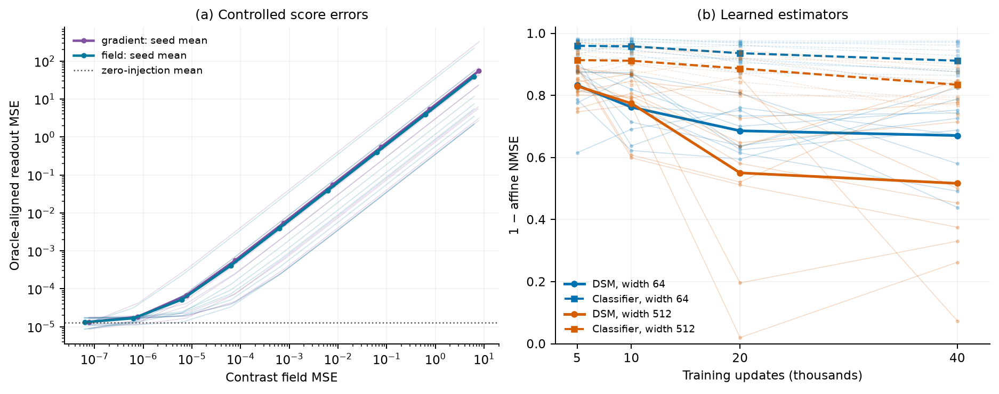
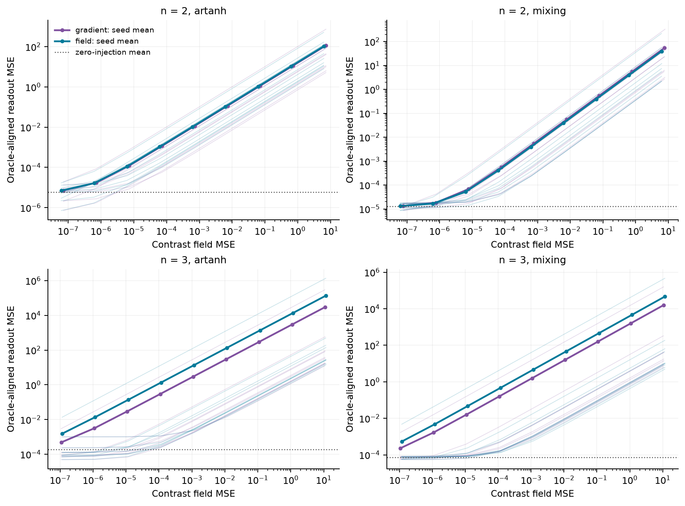
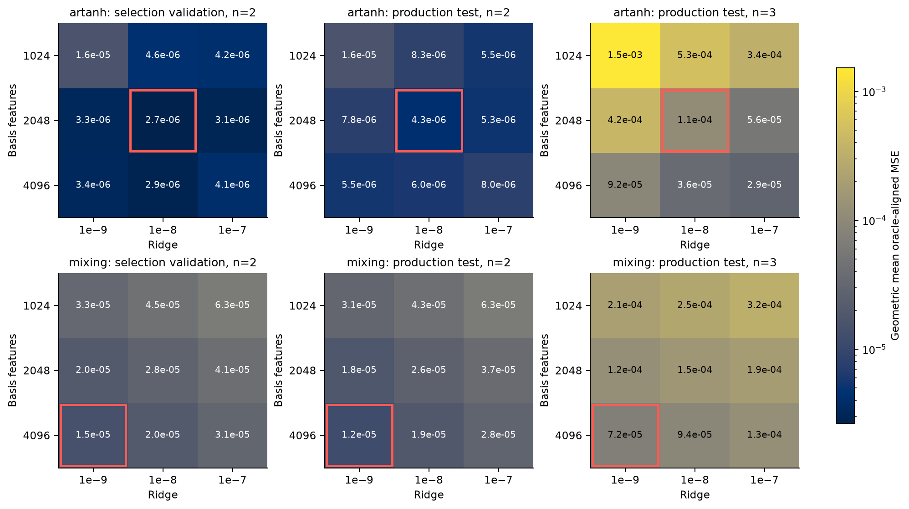
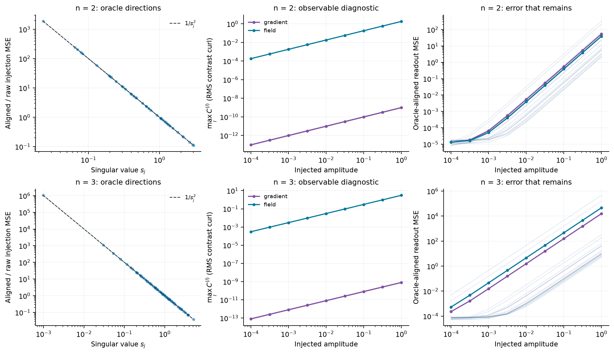
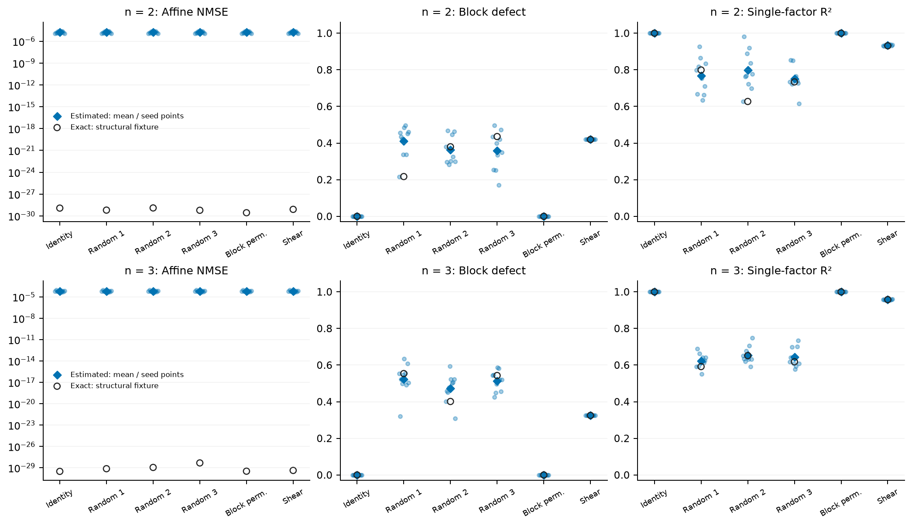

# Figures for the ninth draft

All figures use the completed `rerun-20260926T121833Z` dataset in `data/`.
Regenerate with `PYTHONPATH=src uv run --locked python scripts/reproduce.py` after
installing the extras listed in the README. PDF and SVG are vector outputs; PNG is a preview.
Every plotted measurement is exported to `figures/data.json`, including seed and case.
`figures/manifest.json` links output hashes to the input manifest and rendering source.

## Main text: construction and learned estimates

**Suggested caption.** Numerical illustrations in the fixed n=2 nonlinear-mixing setting,
ten seeds. (a) Measured contrast field MSE versus oracle-aligned readout MSE for conservative
(`gradient`) and nonconservative (`field`) injected score errors. Thin lines show individual
seeds; thick lines join arithmetic seed means at the nine nonzero amplitudes. The dotted
line is the mean zero-injection numerical baseline; zero field error is omitted from the
logarithmic x-axis. Both metrics are squared errors. Linear error injection, a linear ridge
solve and squared evaluation imply the observed scaling; it is not an independent validation
of a theorem's rate or sharpness. (b) Held-out affine recovery for learned estimators, both
evaluated through the same potential route at the same four training budgets from one
training run per seed/width. Solid circles: DSM; dashed squares: classifier (direct log-odds,
Remark `rem:guidance`). Thin lines show the ten seed trajectories for each estimator/width and
thick lines show their means; lines only connect measured checkpoints. Each seed changes the
generated model and samples, so seed SD (not shown here; see `docs/estimators.md`) is not a
confidence interval for one model. The metric in (b) differs from (a): affine calibration can
absorb invertible readout distortions and does not certify factor recovery. Training uses
observed (x,u); ground truth is used for calibration and held-out evaluation. Equal update
counts do not imply equal compute or convergence.

Place this figure beside the numerical-investigation paragraph in Discussion. It gives no
causal attribution to objective mismatch or optimization. Six of ten seeds improve from 20k
to 40k at each DSM width even though the mean declines; the classifier's decline is more
uniform across seeds (1/10 and 0/10 improve from 20k to 40k at widths 64 and 512, 0/10 improve
from 5k to 40k at either width), but this by itself does not establish a cause.

## Supplement S1: full controlled-error design

**Suggested caption.** The same two squared-error metrics as main panel (a), for both
observation maps at n=2 and n=3. Curves show both perturbation kinds at all nine nonzero
amplitudes, including baseline-dominated points; dotted lines mark the zero-injection mean.
Each panel has ten model/sample seeds. No MSE baseline is subtracted. All fields are analytic
or controlled, and the alignment is oracle. The n=3 measurements replicate the construction;
levels across dimensions need not agree.

## Supplement S2: potential approximation and frozen settings

**Suggested caption.** Complete basis-width/ridge grids for the analytic-score baseline.
Cell values are geometric means of oracle-aligned MSE over ten seeds; colors use a common
logarithmic scale. Left: independent selection seeds 100–109, n=2, validation split. Middle
and right: production seeds 0–9 on the test split at n=2 and n=3. Red outlines show the
previously frozen settings; production measurements do not reselect them. The 8192-feature,
1e-8 probe is contextual and excluded from the candidate grid (its values remain in
`data/selection/` and `figures/data.json`). Selection uses ground truth and is an oracle
numerical-setting choice. The mixing setting lies at the candidate boundary and is not
claimed globally optimal. These baselines measure a finite numerical approximation, not a
required accuracy threshold for a learned estimator.

## Supplement S3: conditioning and the reach of curl

**Suggested caption.** Nonlinear mixing at n=2 (top) and n=3 (bottom), ten seeds.
Left: injection-only aligned/raw MSE versus the selected singular value at amplitude one;
the dashed curve is 1/s_j². Singular directions are selected using the true alignment, so
this is an oracle construction check. Middle: maximum over contrasts of RMS contrast curl
versus injected amplitude. Right: the corresponding oracle-aligned readout MSE. Thin lines
are seed values, thick lines are arithmetic means; colors identify perturbation kinds.
Contrast curl is recomputed from the saved perturbations on equal-sized condition strata:
2,000 test points for n=2 and 1,995 for n=3, using central differences with step 1e-5.
It is distinct from the saved per-score curl energy
on 400 points. The conservative perturbation stays near the numerical differentiation floor
while recovery error grows. A small curl does not imply a small conservative estimation error.

## Supplement S4: affine accuracy does not determine factor structure

**Suggested caption.** Six prescribed candidate alignments, n=2 and n=3. Panels show fitted
affine NMSE, the fraction of squared matrix energy outside the best block-permutation
pattern, and single-factor quadratic-regression R². Hollow points are the exact-readout
structural fixture; blue points show the ten estimated nonlinear-mixing seed readouts and
diamonds their means. The exact fixture is not a ten-seed estimate. Fitted affine accuracy
is unchanged by invertible reparameterizations that can destroy block structure. Neither a
small affine error nor a high single-factor R² certifies factorization. Alignments use the
true reference alignment: this is a diagnostic of the metric, not a factorization search.
Both maps' complete seed records are retained in `data/factorization_gap/`.
